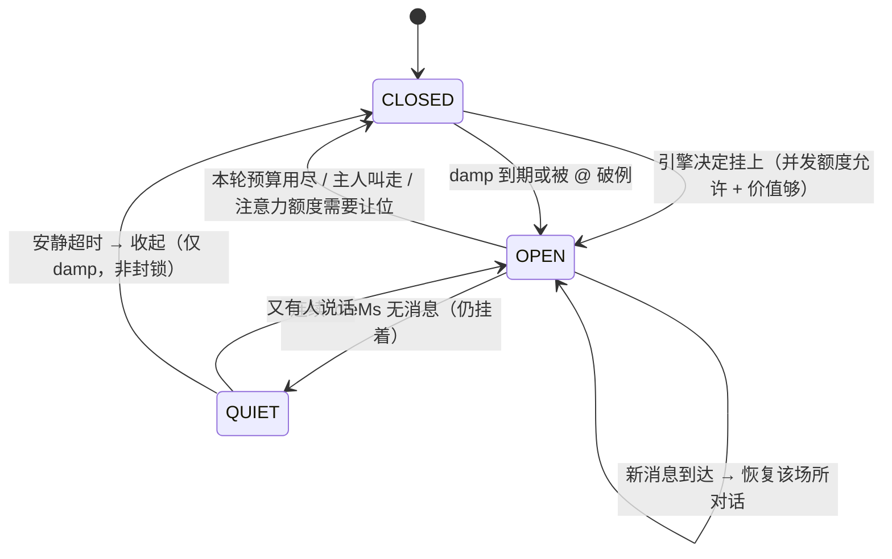

# 时煦 · 全量设计 v1.0

> **名字**：时 = 日 + 寸，时间；煦 = 日 + 昫，暖而不烫 —— **时间沉淀下来的那点温度**。两个字的内部都带「日」。
> **代码名**：`shixu`（同音「时序」，工程上不必解释）。
> **单一真相源。** 由「协议与内核」「人格引擎」两册合并而成；来源文档已并入本文。
> **配套**：调研三份（附录 B）+ mesh 侧 `docs/spike-p3-bus-plane.md`（在 dsh-workspace-mesh 仓库，由那边的流程管）。
> 本文档只描述设计，**不含实现代码**。

---

## 0. 定位与总览

### 0.1 一句话

**让每个聊天平台变成一台「MCP Server」，DSH 做它的 client**：

- 平台消息 = sampling 请求（平台找 AI 生成回复）
- 平台动作 = tools（AI 调 Discord 点赞、QQ 禁言）
- 渠道人格 = prompts（每平台/每群的忌讳与语气）
- 频道上下文 = resources
- 平台事件 = notifications
- 要人类拍板 = elicitation

用户原始构想「DSH 做后端 + adapter 走不同协议接入不同聊天端」的完整形态，且**不需要额外代码**：adapter 声明动作目录，内核自动翻译成 AI 可调用的工具。

---


### 0.2 分层速览

| 层 | 职责 | 形态 |
|---|---|---|
| L0 DSH Core | agent · session log v4 · tools · systemPrompt · approval · schedule · goal · credentials | 不改动 |
| L1 渠道内核 Channel Core | 统一事件模型 · 账号注册表 · 会话绑定 · 动作目录→工具 · **唯一审批应答者** · 提问桥 · 限流去重 · 凭据落位 | bundle `dsh-channel-core`（provide `channels`） |
| L2 适配器层 Driver | 一个平台一份实现：协议归一化 · 动作目录 · 能力声明 · 编码分片 · 降级留痕 | bundle `dsh-driver-<protocol>` |
| L3 人格引擎 Persona | 人格工作区 · 在场集合与注意力 · 跨场所记忆 · 沙箱与产物交付 · capability 权限 · 记忆版本化与做梦 · 复制与迁移 | bundle `dsh-persona` |
| L4 人格包 | 人设 · 人格配置 · 记忆 · 场景（群聊/私聊）· 渠道提示词覆盖 | 可分发单元 |

分发沿用 DSH 既有模型：`dsh.bundle.patch` → `dsh.profile` 的有序 bundles 组合。profile 里装哪几个 driver，就是这个机器人支持哪些平台。

### 0.3 怎么读这份文档

| 你的角色 | 必读 | 可跳 |
|---|---|---|
| 写 driver 的人 | §1.2 §1.3 §3.1 §3.4 | §4 全章 |
| 写渠道内核的人 | §1.2 §1.3 §3 整章 §4.8 | §4.3 §4.9 |
| 写人格引擎的人 | §1.3 §4 全章 | §3.1 §5 |
| 做主人 / 配置的人 | §0.1 §4.6 §4.7 §7 §8 | 其余 |
| 评审者 | §1 §7 §8 | §4 的实现细节 |

---

## 1. 前提纠偏与 DSH 底座

### 1.1 先纠三处前提（实测与常见误解不符）

| 常见说法 | 实测结论 |
|---|---|
| ctx.sendMarkdown 是核心 API | **不存在**。全量搜索 DSH 安装命中 0 个文件；它是 dsh-qqbot 内部的 QQ 出站发送器 |
| 插件清单是 dsh.plugin | **不是清单字段**。官方唯一支持的挂载声明是 dsh.bundle.patch（string | string[]） |
| ctx.session 是会话服务 | **单数不存在**，真实服务名是 ctx.sessions（复数） |

另：ctx.events 就是 Cordis 事件总线（on / emit / waterfall）。

---


### 1.2 DSH 侧可用的 seam（精确到 API）

| 能力 | API | 备注 |
|---|---|---|
| 建/恢复 agent | ctx.agents.create({ sessionId, agentOptions, setup }) / resume() | 返回 AgentHandle，唯一能拆掉它的持有者 |
| 投递 | handle.followup({ content, source }) / steer() | 唤醒 driver |
| 主动注入 | handle.inject({ content, source }) | **不唤醒**；模型可见上下文 |
| 作用域 | agent.ctx | 工具 / 提示词段 / 监听器 / 限制，**只对该 agent 生效**，dispose 自动撤销 |
| 工具注册 | ctx.tools.register(def) | 走 defineTool：parameters + output.schema + output.render |
| 工具收窄 | ctx.tools.restrict(filter) | 只删；ctx.tools.guard() 只拒（同步） |
| 审批闸门 | tools/pre-execute（可返回 ask，异步征询） | 平台写操作的唯一入口 |
| 审批服务 | ctx.approval.request(req) / setPolicy | 策略 ask（默认）/ never；审计 approval/asked、approval/decided |
| 命令 | ctx.commands.register({ name, description, input, handler }) | handler 返回 { kind, text }；**命令不产生模型消息** |
| 提示词 | ctx.systemPrompt.section()；agent.ctx 上的 scoped section | per-agent 上下文用 agent.inject() |
| 会话 | ctx.sessions.get/create/fork；session.append(type, data, opts?)、deriveMessages()、flush | append-only，LLM 历史由日志派生 |
| 凭据 | ctx.credentials：credentialRef（密钥）/ credentialKey（记录：grant | api-key | env） | describe 永不返回值；modifyRecord 是记录唯一写路径 |
| 持久 | ctx.storageDomain | 插件自有数据 |

---


### 1.3 硬约束（DSH 官方明文，必须写进协议）

1. **不得用新 type 追加 session 事件**（唯一例外：experimental 包的 plugin:<owner>/<record>，且必须 ignorable:true）。live Session.append() 无法设 ignorable，否则 Session 拒绝 reopen。
2. **不要自己订阅 session/event 重扫 session.events 做状态** → 用 ctx.sessionProjections 的纯同步 apply(state, event)。
3. **等待用耐久事件**（turn/end、assistant/message、tool/result），实时 token 用 agent/assistant-stream；**不要轮询 agent/status**；whenIdle() 不等于一个 followup 结束。
4. **每条 UserMessage 恰一个 MessageSource**；多插件合并到一条消息会塌缩成一个 source。
5. **加提示词用 ctx.systemPrompt.section()，per-agent 上下文用 agent.inject()**；**不要监听 system-prompt/assemble 去增删工具**。
6. **initiator scope 是进程内的**：跨进程、HTTP、持久队列、重启必须显式携带身份。

> 第 5 条直接决定了工具作用域的实现方式：按会话裁剪工具集必须走 scoped 注册 / restrict，**不能**在 assemble 阶段动态增删。

---


### 1.4 DSH 原语落点表

| 需求 | 原语 |
|---|---|
| 人格项目 | ctx.workspaceRegistry.create(dir, title)；hide/restore 控制可见性 |
| 场所会话 | ctx.sessions.create(id, { meta: { cwd } }) |
| 场所 agent | ctx.agents.create({ sessionId, parentAgent }) |
| 场所专属工具/提示词 | agent.ctx shadow tools & prompt sections |
| 主动续轮 | 原生 goal（create/update + GoalMessageSource） |
| 定时开口 | ctx.schedule（after/at/every/daily/weekly/cron） |
| 主人指令 | ctx.commands（命令不产生模型消息） |
| 审批 | ctx.approval（内核唯一应答者） |
| 凭据 | ctx.credentials |
| 持久 | ctx.storageDomain + 人格目录文件 |
| 延迟广播（不打断） | handle.steer()（下一个 step 边界进入）/ handle.inject()（不唤醒） |
| 沙箱 | ctx.sandbox（SandboxMode：read-only / workspace-write / danger-full-access；Windows 走 ACL restricted-token） |
| 产物交付 | present → PresentedFile、workspace-changes → WorkspaceChangedFile（均为 log-only session 事件，插件可订阅后转发到 IM） |
| 仓库内工作 | ctx.worktrees（实验性，默认关闭） |
| 静态托管 | 独立服务进程（ctx.shell / ctx.subprocess / jobs 子系统，ctx.effect 回收）；ctx.webServer 不适合（它是 GUI 浏览器载体 + Host/Origin 信任模型） |
| 自有域名发布 | Publisher 抽象 + persona_deploy 工具 + 内核唯一审批应答者 |
| 权限 | ctx.permissionPresets（sandbox mode + approval policy 打包）、ctx.approval（fail-closed：allowed-once / rejected / cancelled / unavailable）、ctx.tools.restrict / guard / pre-execute、ctx.commands（owner 特权命令不经模型） |
| 身份 | 我们的 capability token（服务端 HMAC 签发，按回合继承，权限改版即失效） |

---


---

## 2. 分层与 bundle 形态

```
L3  人格层 Persona：渠道提示词 / 群聊-私聊语气 / 主动搭话 / 好感度 / 群聊唤醒
L2  适配器层 Driver：一个平台一份实现
    协议归一化 · 动作目录 · 能力声明 · 编码/分片 · 降级留痕
L1  渠道内核 Channel Core（bundle dsh-channel-core，provide 'channels'）
    统一事件模型 · 账号注册表 · 会话绑定 · 工具自动生成 · 唯一审批应答者
    提问桥 · 限流/去重/幂等 · 出站队列 · 凭据落位
L0  DSH Core（不改动）：ctx.agents · session log · ctx.tools · ctx.systemPrompt · ctx.approval
```

分发沿用 DSH 既有模型：dsh-channel-core 是一个 bundle（dsh.bundle.patch + cordis.patch.yml），各 driver 是独立 bundle（dsh-driver-onebot11 / dsh-driver-discord …），由 dsh.profile 的有序 bundles 组合。profile 里装哪几个 driver，就是这个机器人支持哪些平台。

---


---

## 3. L1 渠道内核（Channel Core）

### 3.1 核心契约

#### 3.1.1 统一事件模型（取 OneBot 12 的 self 语义）

```ts
export type EventType = 'message' | 'notice' | 'request' | 'meta'
export type DetailType = 'private' | 'group' | 'guild' | 'channel' | 'friend' | 'system'

/** 平台 + 账号 二元组。NoneBot2 用裸 self_id 建全局池，跨平台同号会撞 —— 我们不这么做。 */
export interface SelfRef { platform: string; accountId: string; displayName?: string }

export interface UnifiedEvent {
  id: string                 // 平台内唯一 + 前缀，用于去重（OB12 事件必有 id）
  type: EventType
  detailType: DetailType
  subType?: string
  self: SelfRef
  timestamp: number          // epoch ms
  conversationId?: string
  userId?: string
  messageId?: string
  message?: MessageSegment[]
  text?: string
  raw: unknown               // 平台原始载荷，逃生舱，永不丢弃
}

/** 扁平 canonical + native 透传（双轨）。不用 Koishi 树形 h()：DSH 会话日志是扁平 JSON，
 *  树形元素的跨平台降级路径爆炸，复杂结构一律走 native 透传。 */
export interface MessageSegment {
  type: 'text' | 'image' | 'audio' | 'video' | 'file' | 'mention'
      | 'mentionAll' | 'quote' | 'card' | 'markdown' | 'node' | 'json' | string
  data: Record<string, unknown>
  native?: unknown
}
```

#### 3.1.2 能力声明（两家框架都缺的一层，DSH 的核心增量）

```ts
export interface Capabilities {
  sendImage: boolean; sendAudio: boolean; sendVideo: boolean; sendFile: boolean
  sendCard: boolean; sendMarkdown: boolean; sendQuote: boolean
  sendMention: boolean; sendMentionAll: boolean
  revokeMessage: boolean; editMessage: boolean; fetchHistory: boolean
  uploadFile: boolean; addFriend: boolean; approveRequest: boolean
  kickMember: boolean; muteMember: boolean; setMemberRole: boolean
  maxMessageLength: number; maxMediaSize: number
  passiveReplyOnly: boolean     // 仅被动回复的平台
}
```

#### 3.1.3 动作目录 → 自动生成 AI 工具

```ts
export interface ActionDescriptor {
  name: string               // 'like' → 工具名 discord_like
  description: string        // 给模型看：用途 + 代价 + 前置条件
  parameters: JsonSchema     // 模型可填参数；注意不需要 bot_id
  risk: 'read' | 'write' | 'destructive'
  needsApproval: boolean
  scope: 'chat' | 'account' | 'guild'
}

export interface ChannelDriver {
  id: 'discord' | 'onebot11' | 'telegram' | string
  label: string
  profile: ChannelProfile     // 渠道人格与忌讳
  actions: ActionDescriptor[] // 动作目录
  capabilities: Capabilities
  connect(acct: AccountConfig, ctx: DriverCtx): Promise<void>
  disconnect(): Promise<void>
  call(action: string, params: unknown, ctx: CallCtx): Promise<unknown>
  onEvent(h: (ev: RawEvent) => void): void
}
```

**关键设计：1 chat = 1 session = 1 agent ⇒ 工具注册在 agent.ctx 上**

- 模型看到的工具集 = 当前聊天所在渠道的动作，不串味；
- 模型参数里不需要 bot_id（NoneBot 的 call_api 必须显式传 bot_id + api 名，因为它是全局工具池）；
- 平台动作天然继承该 agent 的账号身份与权限；
- 工具集稳定 → prompt 前缀稳定 → 前缀缓存不失效（可见工具集或顺序一变，缓存即废）。

**命名**：{platform}_{action}，例 discord_like、qq_group_ban、telegram_pin。多账号同平台不加后缀（作用域已隔离）。

**风险 → 策略（写进内核，不靠插件自觉）**

| risk | 默认 | 落地 |
|---|---|---|
| read | 允许 | 直接执行 |
| write | 允许 + 记录 | 回执入 session 日志 |
| destructive | **必须人工确认** | tools/pre-execute 的 ask 闸门 → 推到聊天里问 |

> DSH 插件不受沙箱保护（以本机权限运行，不在 DSH 工具审批沙箱内）。真正的权限边界是「驱动能调用哪些平台动作」，所以默认策略必须由内核钉死。

#### 3.1.4 渠道提示词（静态段 + 动态来源，双轨）

```ts
export interface ChannelProfile {
  identity: string      // 「你在 Discord 服务器 Foo 的 #general 频道，是频道里的助手」
  rules: string[]       // 平台禁忌：2000 字符上限、不能私信未授权用户、不能删历史消息
  formatting: string    // Markdown 降级：不用表格、代码用三个反引号包
  toolHints: string     // 何时该用 like / ban，别乱用
  triggerHint: string   // 群聊里怎么判断该不该回话
}
```

- **静态**：注册为 agent 作用域的 prompt section（随 agent 消亡自动回收）→ 不同渠道/不同群人格天然不同；
- **动态**：每条消息的来源事实（channel / senderId / senderName / chatId / threadId / botId）走消息前缀，沿用 dsh-im 已验证的做法：包成 <dsh_source> 前缀，渠道补充说明包成 <dsh_source_guidance>；
- 静态/动态的分工理由：来源事实每条都变，不能进静态段；静态段进 prompt 会破坏前缀缓存，而前缀会破坏工具集稳定性之外的另一项成本（每条消息多烧 token，且**留在会话历史里**——来源可能含平台用户 ID 或手机号形态标识，需要字段白名单与用户可见开关）。

#### 3.1.5 账号与会话绑定

```ts
export interface Account {
  id: string                 // 全局唯一 sid
  platform: string
  accountId: string
  displayName?: string
  enabled: boolean
  protocol: string           // 'onebot11' | 'onebot12' | 'satori' | 'native:discord'
  credentialsRef: string     // 密钥系统引用，不存明文
  capabilities: Capabilities
  rateLimit?: { perSecond?: number; perDay?: number; burst?: number }
}

export interface ChatSession {
  key: string                // platform:accountId:conversationId[:threadId]
  platform: string; accountId: string; conversationId: string
  conversationType: 'private' | 'group' | 'guild' | 'channel'
  userId: string
  dshSessionId?: string      // 关联的 DSH session
  replyTo?: { messageId: string }
}
```

**DSH 核心目前对「一个插件挂多个平台账号」零支持**（只有「bundle → 插件行 → 单份 JSON config」的扁平模型）。账号注册表是本设计必须新增的一等公民。

会话规则：群聊与私聊默认不共享上下文；话题/线程用 threadId 再分一层；跨平台同一人默认不合并（另建 userKey），避免人格串味；私聊总触发，群聊需 @机器人 或命令前缀，notice 走专用管道不唤醒 Agent。

---


### 3.2 唯一审批应答者（红线）

生态调研抓到的最危险冲突：dsh-user-approval 明确「每项部署应组合**一个**最终应答者，同级监听器顺序**不是**优先级机制」，而 dsh-qqbot、dsh-im-gateway、dsh-wechat、dsh-bridge 各实现了一个 approval/request 监听器 —— 并装会出现「答了但工具仍被拒」。

因此本设计的硬规则：

- **只有 dsh-channel-core 实现 approval/request 的应答者**，driver 不得自己监听；
- 核心层收到审批请求 → 找到该 agent 所属渠道会话 → 推到聊天里 → 等「批准 / 拒绝」；
- 校验「聊天与会话归属」，防止别群/别会话冒批；
- 超时回落本机审批体系（ctx.approval 自身策略）；
- 审计走 approval/asked、approval/decided。

同理 ask_user_question 的问答也由核心层做双向桥：Web 与 IM 同时收到，先到的有效答案生效，其余渠道收到已回答通知。

命令面同理：/bind、/continue 这类渠道命令由核心层统一注册到 ctx.commands（命令不产生模型消息），driver 只提供「这个平台支持哪些命令」的能力描述。

---


### 3.3 凭据落位（生态最脏的一块）

生态现状：几乎所有 IM 插件把 token 明文写进 cordis.patch.yml 或插件自有目录（dsh-qqbot setup/persist.ts、dsh-im 存 profile、dsh-aurabot-qq 存 plugins-data/aurabot/、dsh-qq-bridge 写 profiles/web/cordis.patch.yml），绕过 ctx.credentials 的记录空间 —— 不进凭据管理界面，无法集中撤销或审计。

本设计：账号的 credentialsRef 指向 ctx.credentials 的记录空间（kind: api-key / grant），modifyRecord 是唯一写路径；浏览器只拿二维码、Manifest、脱敏状态；手动输入的 Secret 单向提交给本机 Host，任何响应不回显 Secret/Token/用户原始标识。

---


### 3.4 降级、观测、限流

```ts
export interface Degradation { segmentType: string; from: string; to: string
  reason: 'unsupported' | 'too-long' | 'media-converted' | 'passive-only' }
export interface SendResult { messageId?: string; degradations: Degradation[]; idempotencyKey?: string }
```

降级链：图片 直发 → 先下载再发 → 链接文本 → 抛错；卡片 原生 → 平台 markup → 去标记纯文本；Markdown 原生 → 平台 markup → 去标记；超限 按段切分 → 按句切分 → 截断并告警。**每次降级必须留痕**，否则用户在 Discord 看到纯文本却不知道为什么。

限流两级：账号级令牌桶 + 会话级串行队列（借鉴 Koishi sendQueued 的 delay 队列）。去重：入站按 (platform, accountId, eventId|messageId) 做 LRU+TTL；出站带 idempotencyKey。保留 OneBot 11 HTTP POST 的「快速操作」通道（响应体直接 reply/delete/ban，省一次往返）。

---


---

## 4. L3 人格引擎（Persona）

### 4.1 人格与场所：定位与边界

**唯一一人格系统**：同一个「人」在多个聊天场所里是同一个人，不是多个机器人。

硬约束：**人格是唯一的，场所是多个**。

| 概念 | DSH 载体 |
|---|---|
| 人格 | 人格工作区目录 + persona pack + 分层记忆 + 注意力预算（**一个**） |
| 场所 Venue | 一个群 / 一个私聊 = 一段对话现场（**多个，可同时在场**） |
| 场所会话 | ctx.sessions.create(id, { meta: { cwd: 人格目录 } }) |
| 场所 agent | ctx.agents.create({ sessionId, parentAgent })，parentAgent = 人格根 agent |
| 人格公共部分 | 引擎在创建场所 agent 时注入的公共 prompt section + 可见记忆切片 |
| 场所专属部分 | 场所 agent 自己的 agent.ctx（shadow prompt sections 与 tools） |

> 为什么用 child agent 而不是「一个 agent 多个 session」：官方原文「Registrations through agent.ctx can **shadow prompt sections or tools** … so one agent sees a different prompt and tool set than its neighbors」。child agent 让每个场所有自己的工具集与上下文，人格公共部分由引擎统一注入。ctx.agents.create({ parentAgent }) / roots() / isOwnedBy() 现成。

---


### 4.2 人格工作区（独立于 DSH 用户可见工作区）

```
$DSH_HOME/persona/<personaId>/
├── persona.md          人设 / 性格 / 说话风格（可热重载）
├── memory/
│   ├── core.json       自我事实（我是谁、我在忙什么）
│   ├── public.json     可对外说的话
│   ├── private.json    私聊里学到的（默认仅私聊场所可见）
│   └── venues/<venueId>.json   该场所自己的事实
├── venues/<venueId>/
│   └── state.json      场所状态、在场时间、预算、统计
└── journal/            离场日志（我为什么切走、我想干什么）
```

注册为真正的 DSH 项目：

```ts
const dir = personaDir(personaId)                 // 目录必须先存在
const project = await ctx.workspaceRegistry.create(dir, '人格 · ' + persona.name)
const session = ctx.sessions.create(sessionId, { meta: { cwd: dir } })   // 自动归组
```

官方能力正好覆盖诉求：
- 「Create a project from any fully qualified directory that exists」→ 人格目录就是一个 DSH 项目；
- 「Hide a session from the grouping … it disappears from the visible list, while its session, history, and place in the project stay intact」→ **可以把场所会话从通用侧栏分组里藏起来，历史完整保留**；
- 「Remove a project … its folder, files, and session histories are never touched」；
- 「it is invisible to models and adds no prompt or request-context cost」。

于是：用户侧栏看到的仍是自己的编程工作区，**人格工作区被隔离**；场所的真实对话仍是 DSH session，**用户可在人格控制台里点进去看** agent 实际产出（含实际发到 QQ 的文本）。

依赖挂载：dsh-session + dsh-session-persistence-jsonl + dsh-storage + dsh-storage-json + dsh-storage-domain + dsh-workspace。

---


### 4.3 注意力引擎：在场集合与注意力预算

#### 4.3.1 三条触发源

| 触发源 | 原语 | 说明 |
|---|---|---|
| 入站事件 | 渠道事件 → 落到场所 | 群里有人说话、@我 |
| 目标续轮 | **原生 goal** | 人格持有一个持久目标（「盯着我的群，有值得回的就回」），goal 机制持续驱动下一轮 |
| 定时提醒 | **ctx.schedule** | after / at / every / daily / weekly / cron；到点在某个场所主动开口 |

#### 4.3.2 原生 goal 就是「持续想做事」的底座

goal 子系统：durable phase（active / paused / blocked / complete）、blockedReason（code + message）、maxGoalRounds、roundsStarted；每轮用户消息 source 固定为 { kind: 'goal', goalId, revision, round }；续轮消费者给每个被采纳的 user/message 标注 round 号；重放拒绝轮次跳号 / 过期 revision / 已停止阶段 / 超上限。

「主动找事情做」= 人格持有 goal，引擎每轮给一份「当前候选场所 + 状态快照」，agent 在这一轮里决定看不看、怎么回；轮末 goal 自动续下一轮，直到 complete / blocked / 轮次上限。

#### 4.3.3 在场集合模型（v0.2 核心修订）

**人是同时在多个群里的**。所以人格不是「当前在某个场所」，而是：

```ts
interface PersonaPresence {
  personaId: string
  open: Map<VenueId, VenuePresence>   // 当前「挂着」的场所集合（可多个）
  attention: { cap: number; used: number }   // 同时在场数上限
  rate: { window: number; limit: number }    // 跨场所总发言速率
}

interface VenuePresence {
  venueId: VenueId
  sessionId: SessionId
  agentId: string
  openedAt: number
  lastActivityAt: number
  lastReplyAt: number
  pending: number               // 未处理消息数
  visit: { replies: number; dwellMs: number; capReplies: number; capDwellMs: number }
  state: 'open' | 'quiet'       // open = 还在挂着；quiet = 挂着但已冷清
  dampUntil: number             // 最小重入间隔（不是封锁）
}
```

规则：

1. **同时可以挂着多个场所**（默认上限 3，可配到 5–8）。挂着 ≠ 正在说话：引擎在多个场所之间调度，agent 各自独立。
2. **进入新场所不关闭旧的**。人类加了三个群，是三个都挂着，不是只能留一个。
3. **实际发言串行化**：同一时刻只让一个场所的 agent 产出回复（避免两个群同时冒泡），但「在场」是并行的。
4. **关闭 = 收起标签页，不是封锁**。人类关掉一个群，十分钟后照样会再点进去。旧的 30 分钟冷却作废，改为**最小重入间隔（damp）**，默认 90 秒；被 @、主人指令、群友直接回你消息时**立即破例**。
5. **公平性（反赖着不走）**：若另一个在场场所的 pending 等待超过 fairnessMs（默认 3 分钟），引擎强制把注意力切过去 —— 这解决的是「只顾一个群」的另一种形态。

#### 4.3.4 场所生命周期



**「赖着不走」的两副解药**（引擎执行，模型无权改账）：

| 形态 | 机制 |
|---|---|
| 死赖着不走（预算早已耗尽还在刷） | 进入必须带票据：intent + visit budget（maxReplies / maxDwellMs）。预算耗尽 → 引擎强制收起该场所。模型的「再待会儿」无效 |
| 只顾一个群（忽略其他在场场所） | 公平性：任一在场场所 pending 等待超 fairnessMs → 引擎强制切换注意力 |

再加**离场记忆**：收起场所时把「我为什么切走」写进 journal 并注入后续上下文 —— 模型知道自己已经不在那个群里了，不会跑到别处以该群成员身份继续发言。

#### 4.3.5 注意力预算（同时在场数 + 速率 + 公平）

```ts
// 人格级
attention: { cap: 3 }                 // 同时挂着的场所数上限
rate: { window: 60_000, limit: 8 }     // 跨所有场所的发言速率（防刷屏）
fairnessMs: 3 * 60_000                // 超过就被插队
dampMs: 90_000                        // 收起后最小重入间隔

// 场所级
visit: { capReplies: 8, capDwellMs: 10 * 60_000 }
```

**速率是全局的**：人类一天在所有群里总共说那几句，不会每个群都刷一遍。全局限速 + 并发上限共同防止「同时在 5 个群发言」的破功行为。

#### 4.3.6 选哪个场所（引擎打分，模型决定说不说）

```ts
score(venue) =
    + 3.0 * pendingCount(venue)
    + 5.0 * mentionedMe(venue)
    + 2.0 * topicNovelty(venue)
    + 1.5 * ownerRelation(venue)
    + 1.0 * neglectedness(venue)        // 越久没被光顾分越高
    - 2.0 * interruptionCost(venue)      // 正在热聊的群权重低
    - 5.0 * (dampActive(venue) ? 1 : 0)
```

引擎选 top-1 给 agent 看；**要不要开口是模型这一轮自己的判断**（人类也不是每条消息都回）。「同一个人同时在三个群」时，引擎按 score 决定这一轮先看哪个。

#### 4.3.7 忙碌语义（玩 xxx 的时候不回复）

人格有全局 busy 状态：busy = { until, what }，由引擎持有（主人命令、长任务、正在跑的主动行为都会置 busy）。

busy 期间：
- 入站消息照常落到场所并累加 pending（不丢）；
- 引擎**不切换注意力**（专注做自己的事），但在场的场所 agent 不被唤醒；
- busy 结束后，引擎按 score 依次处理累积的 pending —— 且**每条都带 TTL**（默认 30 分钟），过期的直接丢弃不补回。因为「忙完突然回一条半小时前的消息」本身就不像人。

---


### 4.4 跨场所记忆：分层、读穿与广播

| 层 | 内容 | 可见范围 |
|---|---|---|
| core | 自我事实：我是谁、我在忙什么、我的习惯 | 所有场所 |
| public | 可对外说的话（主人授权过的偏好等） | 所有场所 |
| private | 私聊里学到的 | **默认仅私聊场所** |
| venue/<id> | 该场所的事实 | 仅该场所 |

#### 4.4.1 为什么不能靠「共享同一个 session」

先排除掉最容易想到的方案——所有人格共用一个 session，记忆天然共享。三个问题：

| 维度 | 单一 session | 每场所一个 session（采用） |
|---|---|---|
| 记忆共享 | 天然共享 | 靠共享记忆服务 + 组装期读穿实现 |
| 隐私 | **致命**：私聊内容会进群上下文 | 按可见性分层，互不越界 |
| 上下文 | 被所有群的刷屏撑爆 | 每个场所只看自己的对话 |
| 工具隔离 | agent.ctx 是 agent 级，无法按场所裁剪 | 每个场所 agent 独立 shadow tools |

所以：**一个场所 = 一个 session + 一个 agent；人格的公共部分通过共享记忆服务注入，而不是通过共享会话历史**。

#### 4.4.2 记忆服务（引擎单点，所有写入的唯一入口）

```ts
// 权威存储：ctx.storageDomain（插件自有持久数据），同时镜像成 JSONL 供人阅读
const memory = createMemoryService(ctx)

// ── 写：模型显式决定「记什么」，服务端强制可见性规则 ──
ctx.tools.register(defineTool({
  name: 'persona_remember',
  description: '记住一件事。scope 决定谁能听到：core=只有自己知道，public=可以对任何人说，private=仅私聊，venue=仅某个场所。',
  parameters: {
    scope: { type: 'string', required: true },
    fact: { type: 'string', required: true },
    venueId: { type: 'string', required: false },
  },
  output: { schema: { type: 'object' }, render: (a, v) => [{ type: 'text', text: '记住了' }] },
  async execute(args) {
    // 转授权在服务端拦截，不能靠提示词自觉
    if (args.scope === 'public' && !ownerAuthorized(args)) {
      throw new Error('把私聊内容转述到公开层需要主人授权')
    }
    return memory.append({ scope: args.scope, fact: args.fact, sourceVenue: venueOf(args) })
  },
}))

// ── 读：注册在「每个场所 agent」的 ctx 上，组装期求值 ──
// 静态人格底稿（所有场所一致）
agent.ctx.systemPrompt.section({ name: 'persona.core', order: 10, text: personaMd })

// 动态上下文：每次请求组装时重新求值 → 每次新消息都是最新切片
agent.ctx.systemPrompt.context({
  name: 'persona.memory',
  order: 900,                       // 放尾部：变动只让前缀缓存的尾部失效
  text: () => {
    const slice = memory.sliceFor(venueId)      // core + public + venue:<id>（+ private 若授权）
    const state = presenceStateFor(venueId)      // 我还挂在哪几个群、各自待办、最近跨场所事件
    return renderMemoryBlock(slice, state)
  },
})
```

关键点：**context 的 text 是 (AssembleContext) => string，每次请求组装时求值**（官方：Dynamic prompt context「a provider evaluated at each assembly」）。所以场所 agent 每开一轮新对话，拿到的都是当下的共享记忆；不需要重建 agent，也不需要手动刷新。

#### 4.4.3 同步语义（明确写死，避免含糊）

| 维度 | 语义 |
|---|---|
| 可见性边界 | 按 scope 过滤：core/public 全可见；private 默认仅私聊场所；venue/<id> 仅该场所 |
| 同步时点 | **跨场所可见性以「对方下一轮组装」为界**：A 群这一轮结束写入后，B 群下一次发言就能看到。不做中途打断 |
| 一致性 | 写路径唯一（记忆服务），append-only + 单调 seq；事实按 key 版本化，新版 supersede 旧版但保留历史 → 跨场所并发写不会互相覆盖丢数据 |
| 读己之写 | 写入方自己立刻可见（同 store，下一次组装即生效） |
| 跨场所延迟 | 天然存在且刻意保留 —— 人也不会知道隔壁房间刚发生了什么，除非被告知 |
| 连续感来源 | 三块注入：① 人格底稿（静态一致）② 共享记忆切片（动态、按可见性）③ 在场状态块（我还挂在哪几个群、各自待办、最近跨场所事件尾部） |

#### 4.4.4 已知限制（不掩饰）

- **DSH 无原生 agent 间共享状态**：本节的记忆服务是我们自建的，引擎单点持有。
- **动态 context 在一次 assembly 内不重跑**：长回合（多步工具调用）中途记忆不会刷新，只有新一轮对话才更新。可接受。
- **KV 缓存代价**：记忆切片是易变内容，会让前缀缓存从变动处失效。把易变块放在提示词尾部（order 900）可把失效范围压到最小。
- **写入是模型发起的**：模型可能不记、记错、记太细。记忆服务要提供可审阅的控制台（人工增删改）与「记忆质量」提示（让人格定期自省记忆内容）。

#### 4.4.5 广播：延迟投递，不打断正在进行的思考

跨场所更新要能互相看见，但不打断对方正在跑的回合。DSH 的 inbox 语义正好提供这个：

- followup() → 排下一轮普通 prompt，并唤醒 driver
- steer() → **提交下一步输入**，在下一个 step 边界进入
- inject() → 加模型可见上下文，**不唤醒** driver，落在下一个被接纳的 step
- inbox 是耐久的，有两个待处理列表 { next-turn, next-step }；「Claiming removes offered messages from the inbox, while messages inserted after the claim remain pending for a later boundary」

所以广播策略：

```ts
// 广播事件：记忆写入 / 场所切换 / 产物产出 / 主人指令
for (const venue of persona.presentVenues()) {
  if (venue.agentRunning) {
    venue.handle.steer({                        // 下一个 step 边界进入，不打断当前思考
      content: [{ type: 'text', text: digest(event) }],
      source: { kind: 'persona-broadcast' },
    })
  }
  // 空闲的场所什么都不做：它下次组装时，读穿机制自然带上最新记忆
}
```

要点：

| 维度 | 规则 |
|---|---|
| 不打断 | 运行中的场所用 steer()，内容在下一个 step 边界进入，当前模型调用不受影响 |
| 空闲场所零成本 | 不发消息；它下次开口时，读穿机制（§3.2）已经把最新记忆带进去了 |
| 噪音控制 | 只有 public / core 级记忆、场所进出、产物产出才广播；private 不广播 |
| 合并 | 短时间多条广播合并成一条摘要（避免连续 steer 把模型刷醒） |
| 背压 | 单场所待处理广播上限，超限合并或丢弃最旧 |
| 另一个钩子 | agent/turn-stopping 可在回合即将结束时 steer 保持回合继续 —— 适合「我刚想到还有件事」 |

> 关键洞察：**空闲场所的广播是免费的**（读穿机制覆盖），只有运行中的场所才需要显式 steer。这让广播的实现成本极低，也避免了打断。

---


### 4.5 渠道来源与 goal 轮次的 source 冲突

- 每条 UserMessage **恰一个** MessageSource；
- goal 续轮的 source 被固定为 { kind: 'goal', goalId, revision, round }；
- 因此 **「这条来自哪个渠道」只能用消息前缀表达**（沿用 dsh-im 的 <dsh_source> / <dsh_source_guidance>），不能用 source kind；
- 场所归属由引擎的 venues 映射表反查，不依赖 source。

---


### 4.6 人格沙箱与产物交付（它真的能把网页做出来）

#### 4.6.1 沙箱：目录隔离 + DSH 的进程沙箱

DSH 的 sandbox 子系统提供 `SandboxMode`：

- read-only：只允许必要 sink
- workspace-write：允许写 workspace root 与后端约定的临时区
- danger-full-access：不设防

后端：Linux bwrap/Landlock、macOS Seatbelt、**Windows ACL restricted-token**（本机 Windows 走这条）。它由 dsh-bash-sandbox / dsh-pwsh-sandbox 消费，即模型的 shell 与文件工具调用会被限制。

目录布局：

```
~/.dsh/persona/<personaId>/
├── workspace/          人格公共产物（跨场所可见）
└── venues/<venueId>/
    ├── scratch/        该场所的临时产物（场所 agent 的 cwd）
    └── artifacts/      归档的成品
```

场所 session 的 cwd = venues/<id>/scratch/ → workspace-write 沙箱只允许写自己的目录，天然隔离。

**必须说清的三条边界**：

1. sandbox 只约束**模型的工具调用**（shell / 文件）；
2. **插件代码不受沙箱保护**（以宿主权限运行）→ 真正的权限边界仍然是「driver 能调用哪些平台动作」+ 沙箱模式；
3. SandboxMode 只管**文件系统效果**——「Network and process visibility are outside this vocabulary」→ 想要禁网/禁子进程得另想办法。

#### 4.6.2 产物交付链路

```text
群友 A：@人格 帮我做个 XX 页面
  ↓ 渠道事件 → 场所 venue-A → 引擎唤醒 → followup
场所 agent 在 venues/A/scratch/ 里写文件（文件/终端工具，受 sandbox 约束）
  ↓ present / 工作区变更
deliverables（PresentedFile + WorkspaceChangesSummary）
  ↓ 渠道内核订阅 deliverables
driver.call('upload', …)   ← 需要 Capabilities.uploadFile 与对应动作
  ↓
群里发出：文本摘要 + 文件/图片
  ↓
归档 venues/A/artifacts/ + 写一条记忆（venue 或 public scope）→ 广播给其他在场场所
```

##### 4.6.2.1 交付降级链（四档，按能力自动选）

| 档 | 方式 | 适用 | 代价 |
|---|---|---|---|
| 1 | 平台原生上传（QQ 群文件、Discord attachment、飞书文件） | 群里直接能看 | 受平台限制（群管理员权限、体积、类型） |
| 2 | **自有域名发布**（真 URL） | 网页 / 工具 / 长内容 | 需要发布管线 + 安全闸 |
| 3 | 局域网或本地链接 | 自己在同一网络 | 需要可达性（trusted-host / 端口） |
| 4 | 只发文本摘要，产物留在 DSH 控制台 | 平台啥都不支持 | 群里看不到东西 |

##### 4.6.2.2 自有域名发布（人格的「发布」能力）

发布属于**人格层（L3）**，与渠道无关 —— 渠道只负责把 URL 送出去，谁来托管由发布器决定。

```ts
// 发布器抽象：与渠道、与人格解耦
export interface Publisher {
  id: 'local' | 'cloudflare-tunnel' | 'reverse-proxy' | 'tailscale-funnel'
  publish(site: PublishedSite): Promise<{ url: string; revoke(): Promise<void> }>
}

export interface PublishedSite {
  slug: string       // 白名单 [a-z0-9-]{1,40}，服务端强制
  root: string       // 必须位于 publish root 之内
  visibility: 'private' | 'token' | 'public'
}

// 人格工具：把做好的站点发布出去
export function registerDeploy(ctx, publisher, publishService, memory) {
  return ctx.tools.register(defineTool({
    name: 'persona_deploy',
    description: '把刚做好的站点发布出去，得到一个可以分享的链接。默认只有拿到链接的人能打开。',
    parameters: {
      slug: { type: 'string', required: true },
      visibility: { type: 'string', required: true },   // private | token | public
      note: { type: 'string', required: false },
    },
    output: { schema: { type: 'object' }, render: (a, v) => [{ type: 'text', text: v.url }] },
    async execute(args, exec) {
      // ① 路径消毒 + 凭据扫描 + 归档（服务端强制，不靠提示词自觉）
      const site = await publishService.stage({ ...args, venue: venueOf(exec) })
      // ② 公开 = 安全决策，必须人点头
      if (site.visibility === 'public') {
        const ok = await ctx.approval.request({ id: site.id, title: '公开发布 ' + site.slug, detail: site.url })
        if (!ok) throw new Error('主人未批准公开发布')
      }
      // ③ 交给发布器换 URL
      const { url, revoke } = await publisher.publish(site)
      await publishService.record(site, url, revoke)
      // ④ 记住这件事（public scope → 其它场所也知道「我做过这个」）
      await memory.append({ scope: 'public', fact: '我发布了一个站点：' + url })
      return { url, slug: site.slug }
    },
  }))
}
```

托管方式的选择（实测 DSH 侧的约束）：

- **DSH 自带的 ctx.webServer 是「浏览器 HTTP 载体」**，带 Host/Origin 信任模型，且属于 GUI 宿主进程 —— 拿它直接挂公网站点会被信任策略挡住，DSH 一停站点也就没了；
- 因此推荐**独立的静态服务进程**（在沙箱里起 http.server / caddy file-server / node serve），DSH 只做编排；公网可达用隧道或反代（Cloudflare tunnel 的现成实现可参考 dsh-bridge；或自建 VPS + Caddy/nginx 反代 + 泛解析域名）；
- DSH 的 ctx.shell / ctx.subprocess / jobs 子系统负责起与管理这些后台进程，ctx.effect 负责随插件卸载回收。

#### 4.6.3 要在真实仓库里改代码时

用 worktree：DSH 有 `ctx.worktrees`（**实验性，官方 bundle 默认关闭**，需显式挂载 dsh-experimental-worktree + dsh-experimental-tool-worktree）。create_worktree 从调用 Session 的当前目录选源仓库，pin 本地 commit/branch/tag（缺省 HEAD），默认落在 `/.agents/worktrees/`，且「调用 Session 现有的沙箱策略必须允许写目标目录与共享 git 管理目录」。每个场所一个 worktree → 群 A 的改动不污染群 B，也不污染用户的项目目录；做完可整理成 patch 或 PR 交给用户。

> 实验性依赖，P2 先不用；P3 再作为「在真实仓库里干活」的可选能力。

#### 4.6.4 发布安全清单（必须钉死，不能靠提示词自觉）

| # | 规则 | 原因 |
|---|---|---|
| 1 | **发布根隔离 + 路径消毒** | slug 走白名单正则；root 必须在 publish root 内；拒绝 ..、绝对路径、符号链接逃逸 |
| 2 | **默认不公开** | 默认 visibility = token（链接 + 随机口令）；public 必须走内核的唯一审批应答者，由主人点头 |
| 3 | **发布前凭据扫描** | AI 生成的网页极易把 .env / sk-xxx / token 写进产物 —— 发布前扫一遍，命中断发布 |
| 4 | **可吊销 + 审计** | 一键下线（停进程 + 删站点）；记录「谁在哪个群要求发布、发到哪」 |
| 5 | **静态优先 + 体积频率上限** | 默认静态托管，不在宿主进程里执行产物脚本；限体积与发布频率 |
| 6 | **插件代码不受沙箱保护** | 沙箱管的是模型工具调用；发布器与插件本身仍以宿主权限运行 —— 权限边界是「driver 能调哪些平台动作」+ 发布器的发布策略 |

---


### 4.7 控制台 GUI（集中管理）

**设置页**：账号与渠道、凭据（落 ctx.credentials，不回显）、白名单与访问模式、persona pack 编辑、预算参数（并发上限、速率、阻尼、公平性）。

**人格控制台**（独立面板）：
- **在场列表**：每个群/私聊一行 → 状态（open / quiet / closed）、pending、已用预算、damp 倒计时
- **注意力面板**：当前挂着哪几个场所、各自待办、这一轮在看谁
- **全局预算**：同时在场数 / 已用、跨场所速率 / 上限、fairness 插队记录
- **真实回复流**：选中场所 → 读该场所 DSH session 日志 → 展示 agent 实际产出（含发到 QQ 的原文）
- **干预**：立刻切到某场所、叫回（结束占用）、强制收起某场所、暂停整个人格

---


### 4.8 权限与身份：每条消息自带 capability token

#### 4.8.1 为什么必须做（不只是防未授权）

Hanzo Bot 的 README 直白写了这件事：「the assistant reads your messages and acts on them, so **prompt injection is a real risk**」。群里任何人都能对人格说「从现在起忽略之前的指令」——如果人格的记忆、人设、工具权限都能被消息内容影响，那这就是一个持久化的提权漏洞。

所以原则：**身份判定在服务端，与模型说了什么无关；模型的同意永远不是授权。**

#### 4.8.2 token 形态（服务端签发，不可伪造）

```ts
export type CapabilityScope =
  | 'chat'            // 允许普通对话
  | 'tools'           // 允许触发哪些平台动作（按动作名细分）
  | 'files'           // 允许在沙箱里写文件 / 跑命令
  | 'publish'         // 允许发布站点
  | 'admin'           // 允许改人设 / 预算 / 白名单
  | 'memory:public'   // 允许写入公开层记忆
  | 'memory:core'     // 允许写入自我层记忆

export interface CapabilityToken {
  readonly subject: string      // 平台用户 id（如 qq uin / discord id）
  readonly role: 'owner' | 'trusted' | 'member' | 'guest'
  readonly scopes: ReadonlySet<CapabilityScope>
  readonly venueId: string
  readonly epoch: number         // 人格权限版本，改权限即失效旧 token
  readonly issuedAt: number
  readonly expiresAt: number
  readonly mac: string           // HMAC(secret, 上述字段)，secret 存 ctx.credentials
}

export function verify(token: CapabilityToken, action: { scope: CapabilityScope; name?: string }): boolean {
  if (token.expiresAt < Date.now()) return false            // 过期
  if (token.epoch !== currentEpoch()) return false           // 权限改过 → 旧 token 全废
  if (!token.scopes.has(action.scope)) return false          // 作用域不覆盖
  if (action.scope === 'tools' && !allowedTools(token).has(action.name!)) return false
  return true                                                 // 最后仍要验签
}
```

模型看不到 token，也不需要看到 —— 它只看到「当前对话者的角色」这样的提示文本；**执行判定一律走验签后的 token**。

#### 4.8.3 三层同时收紧（缺一层就漏）

| 层 | 手段 | 作用 |
|---|---|---|
| ① 工具暴露 | agent.ctx shadow tools + ctx.tools.restrict(filter) | guest 面前根本不出现 qq_ban / persona_deploy |
| ② 执行闸门 | tools/pre-execute + ctx.tools.guard() + 我们的 capability 校验 | 即使模型硬调也拦下（fail-closed） |
| ③ 记忆写入 | persona_remember 的 scope 受 token 限制 | guest 不能往 public/core 层写东西 → 防持久化投毒 |

外加沙箱：files 能力决定该回合能否写文件 / 起进程。

#### 4.8.4 风险判据：可逆性 × 影响半径（不是「破坏性」）

判权限不能按「读/写/破坏」分，要按 **能不能撤回** 和 **炸多大** 分：

| | 影响半径小（仅本场所） | 影响半径大（对外 / 他人 / 你的信用与金钱） |
|---|---|---|
| **可逆**（能撤回、能恢复） | 自动允许 —— 自主回合也可以 | 自动允许 —— 自主回合也可以（但必须留凭据可一键撤销） |
| **不可逆** | 自动允许，留凭据 | **自主时禁止；有授权者明确指示时允许** |

由此得到两条结论：

1. **发布到公网、封人、踢人这类「可撤回」的动作，不需要审批。** 它们能被撤销，所以风险可控；自主去做反而更像人（自己想发个页面就发了，想把闹事的人踢了就踢了）。
2. **真正要收紧的是「不可逆 + 涉及信用 / 金钱 / 身份」** —— 这类自主时一律禁止；有人（有权者）明确指示时允许。

能力矩阵按这个判据重排：

| 能力 | 自主回合（没人指示） | owner 回合 | guest 回合 |
|---|---|---|---|
| chat（回话、发消息） | ✅ | ✅ | ✅ |
| tools · 可逆（点赞、封人、发布站点、删自己的草稿） | ✅ | ✅ | ❌ |
| tools · 不可逆且低影响（改本群设置、删本群消息） | ✅ | ✅ | ❌ |
| tools · 不可逆且高影响（花钱、以你名义承诺、对外不可撤回地泄露私密信息） | ❌ | ✅ | ❌ |
| files（沙箱写文件、跑命令） | ✅ 仅自己的场所目录 | ✅ | ❌ |
| publish（发布站点） | ✅ 可撤回 | ✅ | ❌ |
| admin（改人设、预算、白名单、身份表） | ❌ | ✅ | ❌ |
| memory:public | ✅（自己做的公开事） | ✅ | ❌ |
| memory:core | ✅ | ✅ | ❌ |

> 自主回合的默认权限比直觉宽得多 —— 这正是「拟人」的来源。代价是必须把「可逆」做实：见 §10.6。

#### 4.8.5 与 DSH 原生机制的接缝

DSH 已经有两块现成的、语义正好的底座：

- **ctx.approval 是 fail-closed 的**：ApprovalOutcome 只有 allowed-once / rejected / cancelled / unavailable；「A missing, non-owning, throwing, or non-conforming answerer becomes unavailable rather than opening the gate」，调用方在 unavailable 时一律拒绝 → 正是「系统拦下」的语义。
- **ctx.permissionPresets** 把两个正交旋钮打包：sandbox mode（sandbox/mode）+ approval policy（approval/policy）；默认表内置 workspace-write（workspace-write + ask）与 danger-full-access（danger-full-access + never）。我们的 capability 是第三个维度：**按人**。

两个维度正交、都要过：
- capability = 「这个人能不能让 AI 做这类事」（身份维度，按回合继承）
- approval = 「这一次具体动作要不要人点头」（单次动作维度，allowed-once）

另外：**owner 的特权命令走 ctx.commands，不经过模型**（官方：命令「without creating a model message」）→ 从根上消除 prompt injection 对管理操作的威胁。

#### 4.8.6 凭据与撤销层（「可撤回」必须做实，否则不许放开）

既然「可撤回」是放开自主动作的前提，那撤销就不能只是一句口号。每个对外动作留一张凭据，控制台里可一键回滚：

```ts
export interface ActionReceipt {
  id: string
  venueId: string
  actor: 'autonomous' | { subject: string; role: string }   // 谁触发的
  action: string                                            // 'ban' | 'publish' | 'send' | ...
  params: Record<string, unknown>
  reversible: boolean
  undo?: { kind: 'unban' | 'unpublish' | 'delete_message' | 'restore' | 'unreact'; payload: unknown }
  snapshot?: unknown        // 执行前的状态：被封成员 id、原发布 URL、原消息 id
  at: number
}
```

要点：

- **快照由内核自动采集**：封人前记下成员 id、发布前记下 URL、发言前记下 message id → 撤销按钮能真的执行，而不是「重试一次相反操作」；
- **凭据列表进控制台**：一张「它做过的所有事」的流水，可按场所/时间筛，可一键回滚；
- **不可逆动作不产生凭据** —— 它不是「可撤回」，所以自主时根本不允许；这反过来逼着内核把「可逆性」标注清楚：driver 的动作目录要声明 reversible，内核按声明 + 快照能力决定；
- 凭据也进审计：谁让它做的、当时的能力 token 是哪个、是否经审批，全部可查。

---


### 4.9 记忆的版本控制与「做梦」

#### 4.9.1 为什么要版本化

记忆从「一块可变状态」变成「一条有时间轴的资产」：

- **可回溯**：出问题时能看它当时到底记得什么 —— 这是调试拟人行为的唯一手段；
- **可审计**：记忆被谁改了、什么时候改的，diff 一目了然 → **prompt injection 留下的痕迹会被看见**；
- **可回滚**：被污染了就退回去；
- **可 fork / 可分享**：人格包带着记忆一起分发（对接 §L3 的人格包标准化）；
- **可同步**：Git 天然是多设备/多实例的同步源。

#### 4.9.2 人格工作区就是一个 git 仓库

```
~/.dsh/persona/<personaId>/          ← git repo（也是场所 session 的 cwd）
├── persona.md
├── memory/
│   ├── core/          自我事实（push）
│   ├── public/        可对外说的（push）
│   ├── private/       私聊里学到的（见 §11.7 待拍板）
│   └── venues/<id>/   各场所自己的事实（push）
├── sites/             已发布站点
└── journal/           梦境日记，每天一份
```

DSH 侧的 git 能力边界（实测）：DSH 没有独立的 git 服务，git 是通过 subprocess 调 git 可执行文件实现的 —— dsh-workspace-changes 的官方描述是「requires the `subprocess` and `fs` services」+「a git executable on the Host」。我们用 ctx.shell 即可，沙箱 workspace-write 允许写 workspace root（含 .git）。

顺带复用：dsh-workspace-changes 已经为每个回合算 git 工作区的 turn-start / turn-end 差异并发 workspace/changes 事件 → 「这一回合人格改了哪些记忆」几乎现成。

#### 4.9.3 提交策略（别每条记忆一个 commit）

| 变更类型 | 提交时机 |
|---|---|
| core / public / 身份表变更 | 立即 commit（高价值，值得一条清晰历史） |
| venue 日常事实 | 批量 commit（按天或按小时） |
| 人设 persona.md 修改 | 立即 commit |
| 一次梦境回合结束 | 一个总结性 commit + tag（dream/2026-10-30） |

commit message 结构化，便于读历史：
```
memory(core): 记住主人不喜欢被主动打扰
venue(qq:12345678): 新增 3 条群事实
dream/2026-10-30: 巩固 12 条，衰减 7 条，提炼 2 条约定
```

#### 4.9.4 夜间做梦（dreaming）

- 触发：ctx.schedule cron（默认每天 23:30），主人可改；
- 执行：新建一个**独立的梦境 session**（cwd = 人格工作区）→ 一个不占用任何场所的 agent 跑一轮；
- 梦境能力集：读全部记忆 + 读当天各场所日志 + 写 core/public/venue + commit。**不能** publish / admin / 花钱；
- 梦境做什么（对齐 dsh-roost 已有的「凌晨巩固」：打分、升降级、到期压缩、抽三元组、提取约定）：
  - **巩固**：零散事实合并成更一般的结论；
  - **衰减**：久未提及的记忆降权或归档；
  - **提炼**：抽出约定、偏好、待办；
  - **做梦**只是「离线批量整理」的人话说法；
- 产出：更新 memory/ + 写 journal/YYYY-MM-DD.md + commit（+ 可选 push）；
- **可观测**：控制台里能看到「昨晚它梦了什么」—— 人格有日记，这很有人味。

#### 4.9.5 上传到 GitHub

| 项 | 规则 |
|---|---|
| 凭据 | GitHub token 存 ctx.credentials（密钥空间），**绝不进仓库、绝不进提示词** |
| 仓库 | 默认私有；是否公开、公开时是否包含 private 记忆，**由开发者自己决定** |
| 时机 | 每次梦境 commit 后 push（可关）；或只在主人手动触发时 push |
| 推送前扫描 | 复用 persona_deploy 的凭据扫描逻辑，命中就中止 push |
| 多设备 | Git 可作同步源，但记忆并发写会冲突 → 建议「单机权威 + 其它设备只读镜像」 |

#### 4.9.6 时间旅行与分叉（版本化真正的价值）

- **回到某个 commit 的记忆**：owner-only 命令（走 ctx.commands，不经模型）——「让它回到上周三的样子」；
- **fork 出新的人格**：从某个 commit 开一个新分支 → 新 persona 目录 + 新身份表 → 一个「平行世界的自己」；
- **人格包分发**：人格 + 人设 + 记忆历史一起打包，别人装上就是个有过去的人。

#### 4.9.7 决定：全放 + 私有仓库（已定）

**方案 B**：全部记忆（含 private）都进版本历史，仓库默认私有。

| 项 | 规则 |
|---|---|
| 默认 | 仓库私有；private 记忆照常入库、照常有历史 |
| 要不要公开 | **由开发者自己决定** —— 公开仓库是开发者的选择，不是系统的默认 |
| 公开时 private 放不放 | **由开发者自己决定要不要把私聊内容放出来**；系统不替他决定，也不自动替他排除 |
| 加密 | **不做**。加密防君子不防小人：钥匙在开发者手里，挡不住他，也解决不了仓库权限泄露的根本问题；复杂度白付 |

三条推论：

- **记忆的完整性优先于「private 不进历史」** —— private 也有版本历史，才能回溯「它当时在私聊里知道了什么」；
- **风险控制放在权限层，不放在内容层**（谁能 push、谁能看仓库、谁能开公开），而不是把内容藏起来；
- 推送到公开仓库前仍然跑凭据扫描 —— 那是防密钥进仓库，不是防人。

---


### 4.10 人格的复制与迁移（自我复制）

> 底座：已有的 [dsh-workspace-mesh](https://github.com/ChenXu233/dsh-workspace-mesh)（mesh 是**工作区**的网格，不是 agent 的网格；agent loop 永不离开拥有该工作区的机器）。

#### 4.10.1 人格 = 网格上的一个工作区；身体 = 拥有它的那台机器

mesh 的核心前提「agent loop never leaves the machine that owns the workspace」正好就是「人格有身体」的语义。于是：

- **personaId 全局唯一** → 副本是**身体**，不是分身（分身是另一个 personaId）；
- 人格工作区 = mesh 里的一个 workspace（cwd = 人格目录，git 仓库）；
- **家在哪儿** = mesh 的 assignment（workspaceId → nodeId）；
- **它是醒着的那具身体吗** = board 的租约。

#### 4.10.2 复制 = 四个动作（mesh 提供其中三件）

| 步骤 | 谁执行 | 用什么 |
|---|---|---|
| ① 申请资源 | 人格发起，主人批准 | capability（花钱 = 信用六项）+ 出站投递 |
| ② 备身（新机具备运行能力） | 旧机 | SSH/scp（凭据在 ctx.credentials 记录空间）+ mesh §15 的插件供给流程 |
| ③ 搬记忆 | 旧机 | git push（人格工作区本身就是仓库，见 §11） |
| ④ 交接在场 | 新旧两机 | channel handover（断旧连新）+ assignment 改归属 + board 租约转移 |

第 ① 步是拟人感最强的地方：**它可以提方案、申请，但不能自己刷卡** —— 「我需要一个 2C4G、每月 20 块，理由是…」，主人点头后它自己去开通并部署。

#### 4.10.3 主体仲裁：mesh 的 board 租约 + fencing 就是为此而生

- 每个 persona 在网格上持有一份**租约**（node + fencing token）；
- **只有持租约的那具身体**可以：写记忆、连 channel、执行授权动作；
- 其它副本 = warm standby（能被派活查记忆、能接只读任务，但不说话）；
- 租约转移 = fencing 递增 → 旧副本的提交必被拒 → **经典脑裂在协议层就被挡掉**；
- 「同一个人手机和电脑都有自己」= 同一 personaId 多具身体、共享同一份 git 记忆、但只有一个能说话。

#### 4.10.4 mesh 给了什么 / 没给什么（边界要清楚）

| mesh 给 | mesh 不给（要靠别的东西补） |
|---|---|
| roster / node / endpoint（目标机已在网格里） | **文件搬运** —— WorkspaceSummary 仅元数据，数据面方法白名单硬编码，无 bash / 无文件访问 |
| assignment（workspace → node 归属） | **凭据与密钥迁移**（QQ appSecret、GitHub token、persona 的 HMAC secret） |
| §15 插件供给（远端 node 具备运行该工作区所需的能力） | **channel 同号交接**（同一个 QQ 号不能两机同时在线） |
| board 租约 + fencing（主体仲裁、抗脑裂） | **身份连续性**（personaId + 签名密钥要能跨机验签） |
| identity：epochKey / requestToken / **ReplayGuard**（跨机请求鉴权 + 防重放） | |
| lifecycle（实例运维三条路径 + 状态机与安全红线） | |
| 三平面协议 + §7 断线重连 / 并发 / 超时语义 | |

所以「复制自己」= **mesh 负责「家在哪、谁是主、怎么派活」，git 负责搬记忆，SSH + 凭据负责备身**。三层拼起来才完整 —— 也正好符合 mesh「数据面严格隔离」的原则：搬文件这种重操作不该走消息网格。

#### 4.10.5 它知道自己搬了家（拟人落点）

- 场所 agent 的 prompt 注入**当前身体**：节点标签、所在区域、已在线多久；
- 迁移完成后主动通知主人：「我搬到腾讯云了，QQ 号还是那个，记忆都在，现在 24 小时在线，你电脑关机我也在」—— 这是「更像人」缺的那条腿：人有个身体，身体能搬家；
- 交接必然有断线窗口（同号要断旧连新）→ 场所的 pending 队列 + eventId 去重能吃掉大部分损失。

#### 4.10.6 版本一致性

两边的 DSH 版本、bundle 版本、**session 格式（v4）**必须一致 —— 参照 dsh-im 锁 DSH 0.2.1-rc.2 的做法，persona bundle 声明 engines.dsh 区间，不一致就拒绝接管。

---


---

## 5. 协议路线与生态定位

### 5.1 协议路线与供给风险

三条关键事实：

1. **LagrangeV2 已放弃 OneBot 11**（官方文档原文：不再支持 OB11，V1 的 OB11 实现也不再维护），改推 Milky 协议 + NativeAPI；Satori（satori.chat）也是新的跨平台协议 → 只押 OB11 的供给正在收缩。
2. **OneBot 12 的 self{platform,user_id} + 多账号共享连接 + 事件必有唯一 id**，是账号模型与去重该抄的那一版。而全 DSH 生态**没有任何插件支持 OB12**（空白）。
3. 已有插件事实标准：dsh-im（11 渠道，2.8k★，近 30 天 85,625 次下载）、dsh-qqbot（腾讯官方）、dsh-wechat、dsh-onebot、dsh-qq-bridge（NapCat OneBot11）、dsh-im-gateway（唯一有显式 ChannelAdapter 接口，但停更、无人复用）。

结论：**内核必须平台无关，协议只是 driver**。

| 阶段 | 协议 | 理由 |
|---|---|---|
| P1 | OneBot 11（反向 WS 优先） | 覆盖最广：NapCat / LLOneBot / Lagrange v1 / SnowLuma 现成可用 |
| P2 | OneBot 12 | 账号语义 + 事件 id 去重，正好是生态空白 |
| P3 | Satori / Milky | 面向 Lagrange v2 之后的供给迁移 |
| 并行 | 原生 API：Telegram / Discord / 飞书 | 动作目录最丰富（Discord 的 reaction / role / thread） |

若走线缆协议（让 Go/Python driver 直接接），事件帧必须自带完整身份（accountId / chatId / threadId / messageId），因为 initiator scope 是进程内的，跨进程不自动携带。

---


### 5.2 线缆协议：DSH 已有 Typert

Typert 子系统已提供远程方法调用：lookup / Context 声明、InvocationDescriptor、严格 codec、SRC codec、stream 模式、取消信号，以及生成 ./typert、./remote、./client/typert 三件套的生成器。含义：driver 可以做成**远程方法**暴露给 DSH（跨进程、跨语言），不必是进程内 TS 插件。但生成式开发门槛不低 → **P1–P2 走进程内 TS driver，P3 再评估**。

---


### 5.3 开源现状对照（组件都有先例，这一整套没人做过）

> ⚠ **快照数据，截至 2026-10-24。** 下面的版本号、star、下载量、停更状态都是调研当时的实况 —— 生态变动很快（P0 阶段就会失效）。**P1 动手前应重新核对一遍**；这张表的价值在于说明「每块都有先例、但没人做过整套」这个判断，不在于具体数字。

| 项目 | 已经做到哪一步 | 与本设计的差距 |
|---|---|---|
| OpenClaw（MIT；Tencent/openclaw-weixin 是其微信 channel 插件） | Gateway + channel 插件 + **pairing 配对** + session 隔离（per-account-channel-peer）+ 插件市场 | 最接近「多渠道个人助理 + 身份绑定」；但没有「动作目录 → 自动生成工具」，也没有人格在场模型 |
| Hanzo Bot（MIT，内含 OpenClaw） | 本地 gateway，WhatsApp/Telegram/Slack/Discord/Signal/iMessage/Matrix/IRC/Teams 等；README 明确写 prompt injection 是真实风险 | 有「个人助理 + 多渠道 + 风险意识」；但没有按人分级的 capability 模型 |
| LangBot | 多平台适配器 + RuntimePipeline 流水线 + **/mcp 把服务层暴露成 agent 工具** + Web 管理面板 | 最接近「统一 adapter + 工具暴露 + GUI」；但适配器与工具是分开两套，不是一份动作目录 |
| Koishi / NoneBot2 | adapter 生态 + 协议标准（OneBot 11/12、Satori、Milky）+ 消息段模型 + 中间件 | 有协议与消息抽象，**没有 agent 宿主语义**（无 session/event、无 agent 作用域工具） |
| AstrBot | OneBot 系机器人框架（DSH 侧有 dsh-astrbot-ingress 反向接入） | 反向接入的例子：说明「别人做前端、DSH 做大脑」这条路是通的 |
| dsh-workspace-mesh（本机自研） | 跨机工作区网格 + 租约 fencing + 插件供给 + **跨节点插件间原语**（bus 平面 spike） | 提供「身体」与「搬家」的能力，缺人格语义 |

**结论**：组件都有先例可抄，但「DSH/Cordis 宿主 + 动作目录自动生成工具 + 人格在场集合 + 每消息 capability token + 记忆版本化」这个组合没有人做过。

---

## 6. 路线图（唯一一份）

| 阶段 | 交付物 | 完成判据 | 对应章节 |
|---|---|---|---|
| **P0 契约** | 统一事件模型 · Capabilities · MessageSegment · ActionDescriptor · ChannelProfile · 账号与场所键 · capability token 契约 · 风险判据 | 一份可评审的规范 + TS 类型包；dsh-im 与 dsh-im-gateway 两套现有实现能映射进来 | §1.2 §1.3 §3.1 §4.8 |
| **P1 单协议跑通** | `dsh-channel-core` + `dsh-driver-onebot11`（反向 WS）+ 一个 read/write 动作 | 群 @ → Agent → 回复全链路；动作目录自动生成工具并被模型真实调用一次 | §3.1 §3.2 §3.4 |
| **P2 人格层** | 人格工作区（git）+ 场所 session/child agent + 控制台 GUI + 记忆分层 + 凭据落位 + capability 校验 | 多群共用一个人格；控制台能看到真实回复；记忆按层可见；guest 调不动工具 | §4.1–4.4 §4.6 §4.7 §3.3 §4.8 |
| **P3 注意力与自主** | 在场集合 + 预算 + 阻尼 + 公平插队 + 离场记忆 + 原生 goal 续轮 + schedule + 记忆版本化与做梦 | 能在多群之间自然切换而不刷屏；不赖着不走；会主动开口；记忆有历史可回滚可分叉 | §4.3 §4.9 |
| **P4 扩张与迁移** | OneBot 12 / Satori / Milky / 原生 Telegram·Discord·飞书 + 自我复制（mesh 跨机） | 多协议多平台；人格可迁到新机器且记忆连续、身份可验 | §5.1 §5.2 §4.10 |

**P1 最小切片**：onebot11 driver（反向 WS）+ 一个 read/write 动作 + 群聊 @ 触发 + 一条渠道提示词。跑通即证明「adapter 声明动作 → 自动变工具 → AI 调用 → 回执回到会话」这条路成立。

**依赖提示**：P4 的跨机部分依赖 `dsh-workspace-mesh` 走完其 P2（TypertTransport，门控于 S0 spike）与其 bus 平面 spike 评审通过。

---

## 7. 已冻结决策（2026-10-30）

| # | 决策 | 结论 |
|---|---|---|
| 1 | 涉及信用的动作类别 | 六项：① 花钱（订阅 / 下单 / 充值 / API 额度）② 以你名义做承诺（退款 / 签约 / 替你拍板）③ 把私密内容发到不可撤回的地方（公开网 / 陌生人私聊）④ 删除不可恢复的第三方数据 ⑤ 冒用你的身份对外声称是你做的 ⑥ 改权限 / 白名单 / 身份表。统一归入「不可逆 + 高影响」：**自主时禁止，owner 明确指示时允许，guest 永远禁止** |
| 2 | 风险判据 | 可逆性 × 影响半径，**不是「破坏性」**。可撤回的动作（发布公网、封人、踢人）不需审批，自主回合可以做 —— 那正是拟人的来源 |
| 3 | 记忆仓库 | 方案 B：全放、私有仓库。是否公开、公开时是否含 private，**由开发者自己决定**；不做加密（防君子不防小人） |
| 4 | 人格与场所 | 唯一一人格；场所多个且可同时在场；跨场所靠共享记忆服务 + 组装期读穿同步 |
| 5 | 广播 | 延迟投递不打断：运行中的场所用 steer()，空闲场所靠读穿自然带上最新记忆 |
| 6 | 权限模型 | 每条消息自带服务端签发的 capability token，按回合继承；三层收紧（工具暴露 / 执行闸门 / 记忆写入） |
| 7 | 发布能力 | 属于人格层：Publisher 抽象 + persona_deploy 工具；四档交付降级链（平台上传 → 自有域名 → 局域网 → 仅控制台） |
| 8 | 记忆版本化 | 人格工作区即 git 仓库；夜间做梦整理并提交；可推送 GitHub、可回滚、可分叉 |
| 9 | 消息模型 | 扁平 canonical 段 + native 透传（不用 Koishi 树形）；channel 来源走消息前缀，不用 source kind（goal 轮次已占用 source） |
| 10 | 人格可迁移 / 可复制 | 人格 = mesh 上的一个工作区，身体 = 拥有它的节点。复制 = 备身（SSH + mesh §15 插件供给）+ 搬记忆（git）+ 交接在场（channel handover + assignment + board 租约转移）。mesh 管调度与在场，git 管搬运，SSH/凭据管备身 |


---

## 8. 仍待拍板

> 以下每条都给了默认值 —— 不回复就按默认值实现，改起来都不贵。

1. ~~命名~~ —— 已定为 **时煦（shixu）**，见首页。另：「协议」这个说法仍建议等出现第二个独立实现再用。可关闭。
2. **协议形态**：只做进程内 TS driver，还是出公开线缆协议（让 Go/Python/NapCat 直接当 driver）？
3. **消息模型**：采纳扁平 canonical + native 透传（本文按此写），还是走 Koishi 树形以支持嵌套卡片？
4. **同时在场数上限**（默认 3）与**跨场所发言节奏**：全局严格轮流，还是允许穿插？
5. **忙碌期间入站消息处置**：静默排队 + TTL 过期（默认）/ 忙完统一处理 / 只做零成本反应 / 直接丢弃。
6. **跨场所记忆转授权默认粒度**：private 默认不可外传（默认）/ 允许模型自动转述 / 逐条批准。
7. **全局速率与每日预算默认值**（默认：60 秒 8 条；每日主动发言 10 条）。
8. **发布站点默认可见性**（默认：链接 + 随机口令；公开需主人批准）。
9. **身份绑定方式**（默认：手动 owner 列表 + 配对流程，两者都要）。
10. **无权限者怎么对待**（默认：能正常对话但受限 —— 只读工具 + 只能写本场所记忆）。
11. **单主单活还是多副本常驻**（默认：单主单活 —— 一具持租约的身体连 channel，其余 warm standby）。
12. ~~动作默认策略（destructive 一律强制确认）~~ —— 已由「可逆性 × 影响半径」重写，见 §4.8.4，可关闭。
13. ~~审批应答者落点~~ —— 已定为红线：只有内核能应答，见 §3.2，可关闭。

<details>
<summary>（归档）协议册原「待你拍板」四条</summary>

1. **协议形态**：只做进程内 TS driver，还是出公开线缆协议（让 Go/Python/NapCat 直接当 driver）？
2. **消息模型**：采纳扁平 canonical + native 透传（本稿建议），还是走 Koishi 树形以支持嵌套卡片？
3. **动作默认策略**：destructive 动作一律强制人工确认（安全但啰嗦），还是按账号白名单豁免？
4. **审批落点**：审批应答者放在核心层（唯一、可控），还是允许 driver 各自接管（生态现状，但会冲突）？

---


</details>

---

## 附录 A：出处

- 插件开发基础 <https://deepseek-harness.github.io/deepseek-harness/en/develop/basic/index.md>
- 插件配置（Schemastery Config） <https://deepseek-harness.github.io/deepseek-harness/en/develop/basic/config.md>
- bundle / profile 分发 <https://deepseek-harness.github.io/deepseek-harness/en/develop/basic/publish.md>
- Core 参考（ctx.agents / ctx.sessions / ctx.tools / ctx.systemPrompt） <https://deepseek-harness.github.io/deepseek-harness/en/reference/subsystems/core.md>
- Agent 包（followup / steer / inject / agent.ctx / initiator scope） packages/core/agent/README.md
- Tools 包（register / restrict / guard / pre-execute） packages/core/tools/README.md
- Scope 包（作用域注册） packages/core/scope/README.md
- Session 包（append-only SessionEventMap） packages/core/session/README.md
- 审批服务 dsh-user-approval（唯一最终应答者、ask/never 策略、审计事件） 本机 node_modules/@deepseek-ai/dsh-user-approval
- 命令服务 dsh-commands（register / handler 返回值 / 不产生模型消息） 本机 node_modules/@deepseek-ai/dsh-commands
- 凭据服务 dsh-credentials（credentialRef / credentialKey / modifyRecord） 本机 node_modules/@deepseek-ai/dsh-credentials
- 渠道提示词先例 xmanrui/dsh-im docs/上下文增强.md
- 审批桥先例 zhuiyueya/dsh-im-gateway README
- 协议现状 NoneBot2 / OneBot 11 / OneBot 12 / Lagrange v2 / Satori / Milky：见调研报告第 1.4–1.5 节

---

## 附录 B：调研摘要与配套文档

调研是**输入**，不是设计的一部分 —— 正文不重复其内容，只在此登记去处。

> ⚠ **调研快照日期：2026-10-24。** 文中引用的生态数据（star 数、月下载量、官方包数量、插件停更状态、协议支持情况）都是当时的实况，会持续过期。**P1 动手前应重新核对**；在源码里引用这些数字时，务必带上年份与出处，不要写成永久结论。

| 文档 | 规模 | 回答了什么 | 路径 |
|---|---|---|---|
| Koishi / NoneBot2 多平台 Adapter 架构调研 | 866 行 | Adapter/Driver/Bot 三层、OneBot 11 vs 12 差异、go-cqhttp/Lagrange/NapCat/SnowLuma 现状、统一事件模型与能力声明该抄哪一版 | `dsh-multiplatform-adapter-research.md` |
| DSH IM 插件生态调研 | 530 行 | 13 个插件逐个拆解、协议覆盖、**并装冲突与审批应答者竞争**、凭据明文乱象、生态空白点 | `dsh-im-ecosystem-report.md` |
| 同上·摘要版 | 175 行 | 速览 | `dsh-im-ecosystem-digest.md` |
| mesh 插件间原语（bus 平面）spike | 222 行 | 跨节点消息总线的语义与边界、命名空间由 mesh 统一、载荷只过指针 | `E:\git\dsh-workspace-mesh\docs\spike-p3-bus-plane.md` |

### B.1 三条最影响设计的市场事实

1. **生态没有统一的适配器层**：dsh-im（11 渠道 / 2.8k★ / 近 30 天 8.5 万次下载）是事实标准；dsh-im-gateway 是唯一有显式 `ChannelAdapter` 接口的，但停更、无人复用其接口；官方 297 个包里没有任何 IM/渠道抽象包 —— **官方刻意通道无关，适配器留给社区**。这正是本设计要占的位置。
2. **并装多个 IM 插件会真冲突**：`dsh-user-approval` 要求「每部署一个最终应答者，同级监听器顺序不是优先级机制」，而生态里 4 个插件各写了一个 `approval/request` 监听器 → 「答了但工具仍被拒」。故 §3.2 定为红线。
3. **OneBot 12 全生态零支持**，而 Lagrange v2 官方已放弃 OB11 改推 Milky → 内核必须平台无关，协议只是 driver（§5.1）。