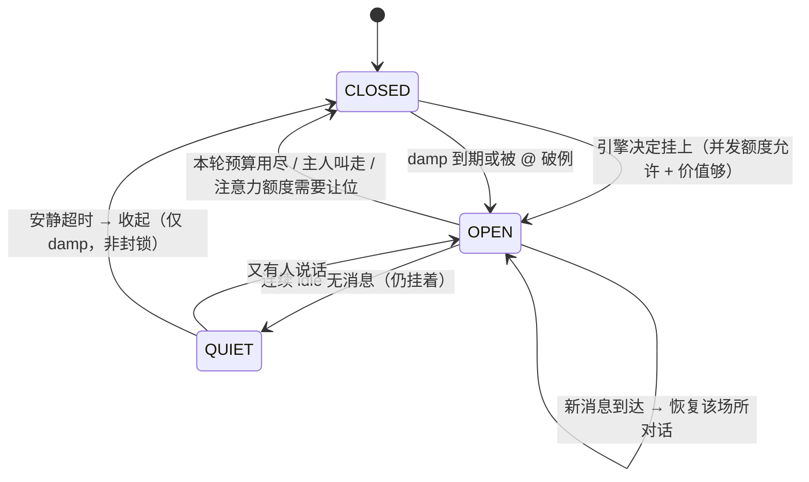

# 人格与场所：一个人同时活在很多个群里

> **状态**：已决议
> **日期**：2026-10-31
> **读者**：写人格引擎的人
> **上游材料**：[人格引擎契约](../reference/contracts-persona.md)、[判据与默认值](../reference/policies.md)
> **口径**：讲模型与取舍；类型定义见契约页，阈值见默认参数表

## 硬约束：人格唯一，场所多个

**唯一一人格系统**：同一个「人」在多个聊天场所里是同一个人，不是多个机器人。

| 概念 | DSH 载体 |
|---|---|
| 人格 | 人格工作区目录 + persona pack + 分层记忆 + 注意力预算（**一个**） |
| 场所 Venue | 一个群 / 一个私聊 = 一段对话现场（**多个，可同时在场**） |
| 场所会话 | `ctx.sessions.create(id, { meta: { cwd: 人格目录 } })` |
| 场所 agent | `ctx.agents.create({ sessionId, parentAgent })`，`parentAgent` = 人格根 agent |
| 人格公共部分 | 引擎在创建场所 agent 时注入的公共 prompt section + 可见记忆切片 |
| 场所专属部分 | 场所 agent 自己的 `agent.ctx`（shadow prompt sections 与 tools） |

为什么用 child agent 而不是「一个 agent 多个 session」：官方原文「Registrations through agent.ctx can **shadow prompt sections or tools** … so one agent sees a different prompt and tool set than its neighbors」。child agent 让每个场所有自己的工具集与上下文，人格公共部分由引擎统一注入。`ctx.agents.create({ parentAgent })` / `roots()` / `isOwnedBy()` 现成。

## 人格工作区被隔离，但不是隐藏

人格目录注册为一个真正的 DSH 项目，官方能力正好覆盖诉求：

- 「Create a project from any fully qualified directory that exists」→ 人格目录就是一个 DSH 项目；
- 「Hide a session from the grouping … it disappears from the visible list, while its session, history, and place in the project stay intact」→ **可以把场所会话从通用侧栏分组里藏起来，历史完整保留**；
- 「Remove a project … its folder, files, and session histories are never touched」；
- 「it is invisible to models and adds no prompt or request-context cost」。

于是：用户侧栏看到的仍是自己的编程工作区，**人格工作区被隔离**；场所的真实对话仍是 DSH session，**用户可在人格控制台里点进去看** agent 实际产出（含实际发到 QQ 的文本）。

## 三条触发源

| 触发源 | 原语 | 说明 |
|---|---|---|
| 入站事件 | 渠道事件 → 落到场所 | 群里有人说话、@我 |
| 目标续轮 | **原生 goal** | 人格持有一个持久目标（「盯着我的群，有值得回的就回」），goal 机制持续驱动下一轮 |
| 定时提醒 | **ctx.schedule** | after / at / every / daily / weekly / cron；到点在某个场所主动开口 |

原生 goal 就是「持续想做事」的底座：goal 子系统有 durable phase（active / paused / blocked / complete）、`blockedReason`（code + message）、`maxGoalRounds`、`roundsStarted`；每轮用户消息 source 固定为 `{ kind: 'goal', goalId, revision, round }`；续轮消费者给每个被采纳的 `user/message` 标注 round 号；重放拒绝轮次跳号 / 过期 revision / 已停止阶段 / 超上限。

「主动找事情做」= 人格持有 goal，引擎每轮给一份「当前候选场所 + 状态快照」，agent 在这一轮里决定看不看、怎么回；轮末 goal 自动续下一轮，直到 complete / blocked / 轮次上限。

## 在场集合

**人是同时在多个群里的。** 所以人格不是「当前在某个场所」，而是「挂着的一组场所」：

1. **同时可以挂着多个场所**（默认上限 3，可配到 5–8）。挂着 ≠ 正在说话：引擎在多个场所之间调度，agent 各自独立。
2. **进入新场所不关闭旧的**。人类加了三个群，是三个都挂着，不是只能留一个。
3. **实际发言串行化**：同一时刻只让一个场所的 agent 产出回复（避免两个群同时冒泡），但「在场」是并行的。
4. **关闭 = 收起标签页，不是封锁**。人类关掉一个群，十分钟后照样会再点进去 —— 所以用**最小重入间隔（damp，默认 90 秒）**，而不是冷却封禁；被 @、主人指令、群友直接回你消息时**立即破例**。
5. **公平性（反赖着不走）**：若另一个在场场所的 pending 等待超过 `fairnessMs`（默认 3 分钟），引擎强制把注意力切过去 —— 这解决的是「只顾一个群」的另一种形态。

### 场所生命周期



### 「赖着不走」的两副解药

引擎执行，模型无权改账：

| 形态 | 机制 |
|---|---|
| 死赖着不走（预算早已耗尽还在刷） | 进入必须带票据：intent + visit budget（`maxReplies` / `maxDwellMs`）。预算耗尽 → 引擎强制收起该场所。模型的「再待会儿」无效 |
| 只顾一个群（忽略其他在场场所） | 公平性：任一在场场所 pending 等待超 `fairnessMs` → 引擎强制切换注意力 |

再加**离场记忆**：收起场所时把「我为什么切走」写进 journal 并注入后续上下文 —— 模型知道自己已经不在那个群里了，不会跑到别处以该群成员身份继续发言。

## 注意力预算

**速率是全局的**：人类一天在所有群里总共说那几句，不会每个群都刷一遍。全局限速 + 并发上限共同防止「同时在 5 个群发言」的破功行为。具体数值见[默认参数](../reference/policies.md#默认参数)。

## 选哪个场所：引擎打分，模型决定说不说

```ts
score(venue) =
    + 3.0 * pendingCount(venue)
    + 5.0 * mentionedMe(venue)
    + 2.0 * topicNovelty(venue)
    + 1.5 * ownerRelation(venue)
    + 1.0 * neglectedness(venue)        // 越久没被光顾分越高
    - 2.0 * interruptionCost(venue)      // 正在热聊的群权重低
    - 5.0 * (dampActive(venue) ? 1 : 0)
```

引擎选 top-1 给 agent 看；**要不要开口是模型这一轮自己的判断**（人类也不是每条消息都回）。「同一个人同时在三个群」时，引擎按 score 决定这一轮先看哪个。

## 忙碌语义

人格有全局 busy 状态：`busy = { until, what }`，由引擎持有（主人命令、长任务、正在跑的主动行为都会置 busy）。busy 期间：

- 入站消息照常落到场所并累加 pending（不丢）；
- 引擎**不切换注意力**（专注做自己的事），但在场的场所 agent 不被唤醒；
- busy 结束后，引擎按 score 依次处理累积的 pending —— 且**每条都带 TTL**，过期的直接丢弃不补回。因为「忙完突然回一条半小时前的消息」本身就不像人。
